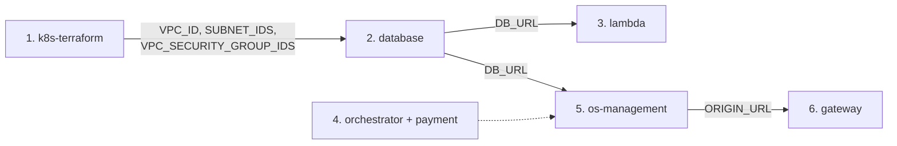

# Deploy na AWS

O sistema está dividido em 7 repositórios, cada um com o próprio pipeline no GitHub Actions. Só as branches `develop` e `main` fazem deploy, e o nome da branch é o nome do ambiente. Os secrets por ambiente usam o sufixo `_DEVELOP` ou `_MAIN`, e o pipeline escolhe o valor pela branch.

Nenhum stack lê o state Terraform de outro. Os valores que um repositório precisa de outro (VPC, subnets, URL do banco) entram como secrets preenchidos à mão, a partir dos outputs do stack anterior. Por isso a ordem abaixo importa: cada etapa produz valores que a próxima consome.

> [!info] Conta e região
> A região é definida pelo secret `AWS_REGION`, que é **obrigatório**: sem ele, os stacks e pipelines caem no padrão `us-east-1` e o deploy vai para a região errada. Os comandos deste guia leem a mesma região da variável de ambiente `AWS_REGION` (por exemplo, `export AWS_REGION=us-east-2`).

> [!attention] Não use a conta do AWS Academy
> O Learner Lab do AWS Academy não deixa criar usuários IAM nem access keys próprias. As únicas credenciais são as temporárias do lab, que expiram a cada sessão, e por isso não dá para criar o usuário de deploy que os pipelines usam. Faça o deploy com uma **conta AWS pessoal** e um usuário IAM com access keys permanentes. Com essas chaves o `AWS_SESSION_TOKEN_DEVELOP` não é necessário e pode ficar vazio.

---

## Etapa 0 — Pré-requisitos (uma vez por conta)

### Bucket de state do Terraform
O Terraform não cria o próprio backend, então o bucket precisa existir antes do primeiro deploy. Um bucket serve os dois ambientes, porque a chave do state já separa componente e ambiente (`<componente>/<env>/terraform.tfstate`). O lock é nativo do S3 (`use_lockfile=true`), sem tabela DynamoDB.

O nome do bucket termina com o **ID da sua conta AWS**. Nomes de bucket S3 são únicos no mundo inteiro, e o sufixo com o ID da conta evita colisão entre contas diferentes. O comando abaixo descobre o ID sozinho a partir das credenciais configuradas. Use o nome resultante no secret `TF_STATE_BUCKET_*`.

```bash
export AWS_REGION=us-east-2   # a mesma região do secret AWS_REGION
ACCOUNT_ID=$(aws sts get-caller-identity --query Account --output text)
BUCKET=os-management-tfstate-$ACCOUNT_ID
aws s3api create-bucket --bucket "$BUCKET" \
  --create-bucket-configuration LocationConstraint="$AWS_REGION"   # omita esta linha se a região for us-east-1
aws s3api put-bucket-versioning --bucket "$BUCKET" --versioning-configuration Status=Enabled
aws s3api put-bucket-encryption --bucket "$BUCKET" \
  --server-side-encryption-configuration '{"Rules":[{"ApplyServerSideEncryptionByDefault":{"SSEAlgorithm":"AES256"}}]}'
aws s3api put-public-access-block --bucket "$BUCKET" \
  --public-access-block-configuration BlockPublicAcls=true,IgnorePublicAcls=true,BlockPublicPolicy=true,RestrictPublicBuckets=true
```

> [!warning] O state guarda segredos em texto puro
> A senha do banco e o segredo JWT ficam legíveis no state. Versionamento, criptografia e bloqueio de acesso público não são opcionais.

### Secrets base
Configure estes antes de qualquer deploy. Todos os repositórios usam.

| Secret | Valor |
|---|---|
| `AWS_ACCESS_KEY_ID_DEVELOP` / `_MAIN` | Access key do usuário de deploy |
| `AWS_SECRET_ACCESS_KEY_DEVELOP` / `_MAIN` | Secret key do usuário de deploy |
| `AWS_SESSION_TOKEN_DEVELOP` | Não é necessário com conta pessoal. Só se usa com chaves temporárias (prefixo `ASIA...`) |
| `AWS_REGION` | Região do deploy, por exemplo `us-east-2`. Obrigatório |
| `AWS_ACCOUNT_ID_DEVELOP` / `_MAIN` | ID da sua conta (12 dígitos), obtido com `aws sts get-caller-identity --query Account --output text` |
| `TF_STATE_BUCKET_DEVELOP` / `_MAIN` | Nome do bucket criado acima |

O `AWS_ACCOUNT_ID_*` funciona como trava: se estiver errado, o Terraform falha logo com erro de conta, em vez de fazer deploy no lugar errado.

---

## Ordem de deploy



| # | Repositório | Precisa de (preencher antes) | Produz (preencher depois) |
|---|---|---|---|
| 1 | `os-management-k8s-terraform` | Secrets base | `VPC_ID_*`, `SUBNET_IDS_*`, `VPC_SECURITY_GROUP_IDS_*` |
| 2 | `os-management-database` | `VPC_ID_*`, `SUBNET_IDS_*`, `DB_USERNAME`, `DB_PASSWORD` | `DB_URL_*` |
| 3 | `os-management-lambda` | `DB_URL_*`, `SUBNET_IDS_*`, `VPC_SECURITY_GROUP_IDS_*`, `DB_USER`, `DB_PASSWORD`, `JWT_SECRET` | — |
| 4 | `os-orchestrator`, `os-payment` | Secrets base (+ Docker e `USE_AWS` no orchestrator) | — |
| 5 | `os-management` | `DB_URL_*`, `DB_USER`, `DB_PASSWORD`, `JWT_SECRET`, Docker, `USE_AWS` | `ORIGIN_URL` / `ORIGIN_URL_MAIN` |
| 6 | `os-management-gateway` | `ORIGIN_URL` / `ORIGIN_URL_MAIN` | URL pública da API (`invoke_url`) |

Para fazer o deploy de cada etapa, faça push (ou merge de PR) na branch do ambiente, `develop` ou `main`. Os comandos abaixo usam `develop`; para `main`, troque o sufixo dos nomes.

---

## 1. `os-management-k8s-terraform`

Cria a VPC compartilhada e o cluster EKS `os-management-<env>`.

**Depois do deploy, preencha:**

| Secret | Origem |
|---|---|
| `VPC_ID_DEVELOP` | output `vpc_id` |
| `SUBNET_IDS_DEVELOP` | output `private_subnet_ids`, como lista JSON: `["subnet-a","subnet-b"]` |
| `VPC_SECURITY_GROUP_IDS_DEVELOP` | output `node_security_group_id`, como lista JSON: `["sg-..."]` |

Se não tiver acesso ao state, os mesmos valores saem direto da AWS:

```bash
ENV=develop
VPC_ID=$(aws ec2 describe-vpcs --filters Name=tag:Name,Values=os-management-$ENV-vpc \
  --query 'Vpcs[0].VpcId' --output text); echo "$VPC_ID"

aws ec2 describe-subnets --filters Name=vpc-id,Values=$VPC_ID Name=tag:Name,Values='*private*' \
  --query 'Subnets[].SubnetId' --output json

aws ec2 describe-security-groups --filters Name=tag:Name,Values=os-management-$ENV-node \
  --query 'SecurityGroups[].GroupId' --output json
```

---

## 2. `os-management-database`

Cria a instância RDS Postgres `workshop-<env>` e aplica `scripts/ddl.sql` e `scripts/dml.sql`. Apesar dos nomes `aurora_*` nos recursos, é RDS comum.

**Antes:** `VPC_ID_*`, `SUBNET_IDS_*`, `DB_USERNAME`, `DB_PASSWORD`. Este repositório não recebe security group; ele cria o próprio.

**Depois do deploy, preencha:**

| Secret | Origem |
|---|---|
| `DB_URL_DEVELOP` | output `aurora_jdbc_url` (`jdbc:postgresql://<endpoint>:5432/workshop-develop`) |

```bash
aws rds describe-db-instances --db-instance-identifier workshop-develop \
  --query 'DBInstances[0].Endpoint.Address' --output text
# DB_URL = jdbc:postgresql://<endereço>:5432/workshop-develop
```

---

## 3. `os-management-lambda`

Cria as Lambdas `os-auth-issuer-<env>` e `os-auth-authorizer-<env>`, dentro da VPC para alcançar o banco.

**Antes:**

| Secret | Valor |
|---|---|
| `DB_URL_*` | Etapa 2 |
| `SUBNET_IDS_*` | Etapa 1 |
| `VPC_SECURITY_GROUP_IDS_*` | Etapa 1 |
| `DB_USER` | Mesmo valor de `DB_USERNAME` |
| `DB_PASSWORD` | Mesmo da etapa 2 |
| `JWT_SECRET` | Precisa ser **igual** ao do `os-management`, senão o token emitido aqui é recusado pela aplicação |

---

## 4. `os-orchestrator` e `os-payment`

Os dois criam só o que consomem (filas SQS com DLQ e tabelas DynamoDB) e referenciam filas de outros serviços pelo nome. Não dependem de VPC, cluster nem banco, então podem ir a qualquer momento depois da etapa 0. O pod do orchestrator só sobe depois que o cluster da etapa 1 existe.

| Repositório | Além dos secrets base |
|---|---|
| `os-orchestrator` | `DOCKER_USERNAME`, `DOCKER_HUB_TOKEN`, `DD_API_KEY`, variável `USE_AWS=true` |
| `os-payment` | `MERCADO_PAGO_ACCESS_TOKEN` |

---

## 5. `os-management`

Aplicação Spring Boot no EKS (`kubectl apply -k k8s/`), mais o stack Terraform da fila de eventos própria.

**Antes:**

| Nome | Tipo | Valor |
|---|---|---|
| `USE_AWS` | **variável** | `true`. Sem ela, o deploy no EKS é pulado e o pipeline fica verde mesmo assim |
| `DB_URL_*` | secret | Etapa 2 |
| `DB_USER`, `DB_PASSWORD` | secret | Mesmos do banco |
| `JWT_SECRET` | secret | Igual ao da etapa 3 |
| `DOCKER_USERNAME`, `DOCKER_HUB_TOKEN` | secret | Docker Hub (o nome é `DOCKER_HUB_TOKEN`, não `DOCKER_PASSWORD`) |
| `DD_API_KEY`, `DD_APP_KEY` | secret | Datadog |
| `DD_SITE` | variável | Site do Datadog |
| `SONAR_TOKEN` / `SONAR_ORGANIZATION` | secret / variável | SonarCloud |

**Depois do deploy, preencha:**

| Secret | Origem |
|---|---|
| `ORIGIN_URL` (develop, **sem sufixo**) / `ORIGIN_URL_MAIN` | Hostname do LoadBalancer do Service `os-management`, no formato `http://<hostname>:8080` |

```bash
aws eks update-kubeconfig --name os-management-develop --region "$AWS_REGION"
kubectl get svc os-management -n os-management \
  -o jsonpath='{.status.loadBalancer.ingress[0].hostname}'
```

> [!tip] Pod em CrashLoopBackOff
> Se o pod reinicia em loop, veja o log da execução que falhou com `kubectl logs -n os-management <pod> --previous`. Os avisos do HPA sobre métricas de CPU são consequência de não haver pod pronto.

---

## 6. `os-management-gateway`

Cria o API Gateway REST, as rotas e o authorizer JWT. Os nomes das Lambdas são derivados (`os-auth-<issuer|authorizer>-<env>`), então não há secret da etapa 3. Se as Lambdas ainda não existirem, o `apply` termina e as rotas respondem 5xx até elas subirem.

**Antes:** `ORIGIN_URL` / `ORIGIN_URL_MAIN` da etapa 5.

**Resultado:** o output `invoke_url` é a URL pública da API.

---

## Quando o valor muda, o que refazer

| Mudou | Atualize | Refaça o deploy de |
|---|---|---|
| Credenciais AWS (rotacionadas) | `AWS_ACCESS_KEY_ID_*`, `AWS_SECRET_ACCESS_KEY_*` | O que for rodar em seguida |
| Conta AWS | Secrets base + novo bucket de state; tudo é recriado do zero | Todas as etapas, na ordem |
| VPC/cluster recriados | `VPC_ID_*`, `SUBNET_IDS_*`, `VPC_SECURITY_GROUP_IDS_*` | 2, 3, 5, 6 |
| Banco recriado | `DB_URL_*` | 3, 5 |
| LoadBalancer do app recriado | `ORIGIN_URL` / `ORIGIN_URL_MAIN` | 6 |
| `JWT_SECRET` | `JWT_SECRET` | 3 e 5 |

Veja também: [[Variaveis de Ambiente]].
